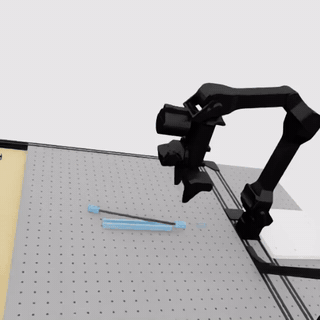
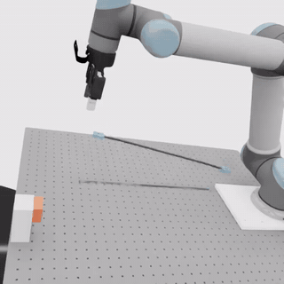
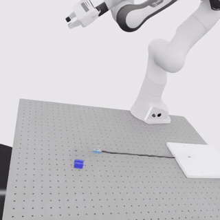
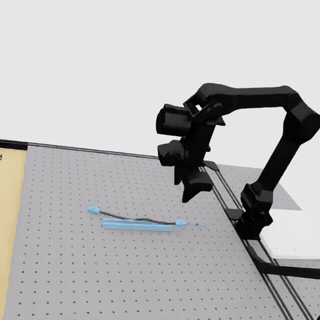

# WireCraft

**A Simulation Benchmark for Industrial DLO Manipulation**

[Paper](https://arxiv.org/abs/2606.18097) · [Project page](https://chongyuzhu.com/wirecraft/)

WireCraft is a simulation benchmark for connector insertion, clip routing, and channel seating with articulated and FEM-based deformable wire models.

## Software versions

WireCraft was developed with **[Isaac Lab v2.2.1](https://isaac-sim.github.io/IsaacLab/v2.2.1/index.html)** and **[Isaac Sim 4.5](https://web.archive.org/web/20260520100346/https://docs.isaacsim.omniverse.nvidia.com/4.5.0/index.html)**, and validated on **[Isaac Sim 5.1](https://docs.isaacsim.omniverse.nvidia.com/5.1.0/index.html)**.

Some APIs have changed in later Isaac Sim versions. We plan to release a version compatible with **[Isaac Sim 6.0](https://docs.isaacsim.omniverse.nvidia.com/6.0.0/index.html)** and **[Isaac Lab 3.0](https://isaac-sim.github.io/IsaacLab/v3.0.0/index.html)**.

## Installation

1. Install Isaac Sim [4.5](https://docs.isaacsim.omniverse.nvidia.com/4.5.0/installation/index.html) or [5.1](https://docs.isaacsim.omniverse.nvidia.com/5.1.0/installation/index.html).
2. Clone this repository and install it the way Isaac Lab is installed
   ([Isaac Lab v2.2.1 guide](https://isaac-sim.github.io/IsaacLab/v2.2.1/source/setup/installation/index.html)):

```bash
git clone https://github.com/DORLR/WireCraft.git && cd WireCraft
ln -s <path-to-isaac-sim> _isaac_sim   # binary Isaac Sim only; skip for the pip install
./isaaclab.sh --conda wirecraft && conda activate wirecraft   # optional: a dedicated conda env
./isaaclab.sh --install
```

3. Optional, for [imitation-learning data](#collecting-demonstrations-lerobot-v30): converting or uploading
   datasets needs [LeRobot](https://github.com/huggingface/lerobot) **>= 0.4** (dataset format v3.0; tested with
   0.5.2). Install it in a separate environment, since it pins its own PyTorch, and log in to upload:

```bash
conda create -n lerobot python=3.12 -y && conda activate lerobot
pip install "lerobot>=0.4"
huggingface-cli login   # only to push datasets to the Hugging Face Hub
```

## Check the environments

A random policy exercises resets and physics; leave out `--headless` to watch it in the viewer:

```bash
python scripts/wirecraft/run.py --task WireCraft-UR5-Articulation-StackedCuboid-Insertion-v0 --mode random --num_envs 4
python scripts/wirecraft/run.py --task WireCraft-Franka-Deformable-StackedCuboid-1Clip-Routing-v0 --mode random --num_envs 4
python scripts/wirecraft/run.py --task WireCraft-Trossen-Articulation-StackedCuboid-StraightChannel-v0 --mode random --num_envs 4
# headless, with a video of env 0 and a result.json
python scripts/wirecraft/run.py --headless --task WireCraft-UR5-Articulation-StackedCuboid-Insertion-v0 \
    --mode random --num_envs 4 --video --output out/random_ur5_insertion
```

## Environments

96 environments: 3 robots (UR5, Franka, Trossen) x 2 wires (articulated, FEM deformable) x connector insertion,
clip routing and laying a wire in a channel, with 8 connectors. See the
[environment summary](docs/wirecraft/ENVIRONMENTS.md) for IDs, spaces and coverage.

## Scripted policies

Scripted policies run through the normal action interface. Insertion works with every connector; 1-clip routing and
straight channels with the stacked cuboid. In clip routing, an O-shaped holder stabilizes the wire in the gripper
to keep the gripper in contact with it. For example, UR5 insertion:

```bash
python scripts/wirecraft/run.py --headless --task WireCraft-UR5-Articulation-StackedCuboid-Insertion-v0 \
    --mode scripted --num_envs 5 --video --output out/scripted_ur5_insertion
```

Videos play at 2x speed: UR5 insertion, Franka clip routing, Trossen channel seating.

| Wire | Insertion (UR5) | 1-clip routing (Franka) | Straight channel (Trossen) |
| --- | --- | --- | --- |
| Articulated |  |  |  |
| Deformable |  |  |  |

## Training PPO

```bash
python scripts/reinforcement_learning/rsl_rl/train.py --headless \
    --task WireCraft-UR5-Articulation-StackedCuboid-Insertion-v0 --num_envs 1024
# score a checkpoint (one deterministic episode per env; add --video env0.mp4 to record)
python scripts/wirecraft/eval_checkpoint.py --headless \
    --task WireCraft-UR5-Articulation-StackedCuboid-Insertion-v0 --checkpoint logs/rsl_rl/<run>/model_<n>.pt \
    --num_envs 100 --output eval.json
```

Any `env.*` or `agent.*` field can be overridden on the command line or with `--experiment file.yaml`.

> **Reward disclaimer.** The insertion reward in this release has only been tested with PPO on the printable
> connectors (UR5, articulated wire). The real connectors, the other robots and the clip-routing and channel
> rewards have not been tested for learning. You are welcome to plug in your own reward: each task's reward is
> one method, `rewards()` in `source/isaaclab_tasks/isaaclab_tasks/direct/wirecraft/single_arm/common/tasks/<task>.py`.

## Collecting demonstrations (LeRobot v3.0)

Record scripted or RL rollouts, then convert them into a [LeRobot](https://github.com/huggingface/lerobot) v3.0
dataset for imitation learning:

```bash
python scripts/wirecraft/collect_demos.py --headless --task WireCraft-UR5-Articulation-StackedCuboid-Insertion-v0 \
    --policy scripted --num_episodes 50 --cameras side2 color --only_success --output demos/ur5_insertion
#   --policy rl --checkpoint model.pt   records a trained policy instead
python scripts/wirecraft/to_lerobot.py demos/ur5_insertion --repo_id <hf_user>/wirecraft_ur5_insertion \
    --root datasets/ur5_insertion --push_to_hub   # in the lerobot environment; drop --push_to_hub to keep it local
```

Video encoding dominates the conversion time; `--vcodec h264` is faster than the default AV1.

## Wrist force/torque sensor (demo)

```bash
python scripts/wirecraft/demo_ft_sensor.py --headless --output out/ft_demo
```

## Code layout

Built on Isaac Lab v2.2.1; the WireCraft code lives in:

| What | Path |
| --- | --- |
| Wire, port/socket, clip and channel spawners | `source/isaaclab/isaaclab/sim/spawners/{wires,ports,channels}` |
| Tasks, robots, scripted policies, configs | `source/isaaclab_tasks/isaaclab_tasks/direct/wirecraft` ([README](source/isaaclab_tasks/isaaclab_tasks/direct/wirecraft/README.md)) |
| Connector, fixture and robot assets | `source/isaaclab_assets/isaaclab_assets/data/wirecraft` |
| Run, verify, evaluate, collect | `scripts/wirecraft` |
| PPO training | `scripts/reinforcement_learning/rsl_rl/{train,play}.py` |

The UR5 (with Robotiq 2F-85 and wrist camera) and the table ship in `data/wirecraft/robots/`; Franka is loaded
from Isaac Lab's Nucleus, and the Trossen AI Stationary kit from the TrossenRobotics repository at a pinned commit.

## Development in progress

This release contains the environments and a PPO-learnable reward for part of the tasks, so it is not complete
yet. The remaining components will come in later updates. Contributions are welcome: please open an issue or a
pull request.

## Citation

If you use **WireCraft** in your research, please cite our paper:

```bibtex
@misc{zhu2026wirecraft,
  title = {WireCraft: A Simulation Benchmark for Industrial DLO Manipulation},
  author = {Zhu, Chongyu and ElMallah, Ramy and Kim, Hyegang and Tang, Zachary
            and Rao, Jiachen and Arutyunov, Artem and Ha, Seungyeon and Lee, Chi-Guhn},
  year = {2026},
  eprint = {2606.18097},
  archivePrefix = {arXiv},
  primaryClass = {cs.RO},
  note = {CoRL 2026 (Spotlight)},
  url = {https://arxiv.org/abs/2606.18097}
}
```

## Acknowledgments

WireCraft builds on NVIDIA Isaac Sim and Isaac Lab. We thank NVIDIA, the Isaac Lab project developers, and the original asset creators for the simulation tools and assets used in this project.

NVIDIA and third-party assets retain their original copyright notices and license terms. See the [Isaac Sim 5.1 license documentation](https://docs.isaacsim.omniverse.nvidia.com/5.1.0/common/legal.html).

## References

1. NVIDIA. [*Isaac Lab: A GPU-Accelerated Simulation Framework for Multi-Modal Robot Learning*](https://arxiv.org/abs/2511.04831). arXiv:2511.04831, 2025. [Official citation metadata](https://github.com/isaac-sim/IsaacLab/blob/main/CITATION.cff).
2. NVIDIA. [*Isaac Sim*](https://github.com/isaac-sim/IsaacSim/blob/v5.1.0/CITATION.cff). Software, version 5.1.0. [Versioned documentation](https://docs.isaacsim.omniverse.nvidia.com/5.1.0/index.html).
